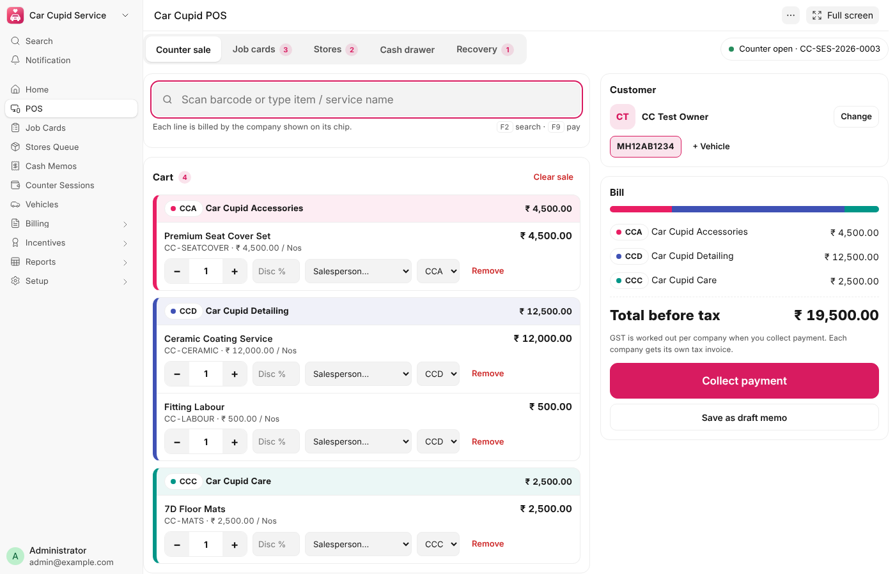
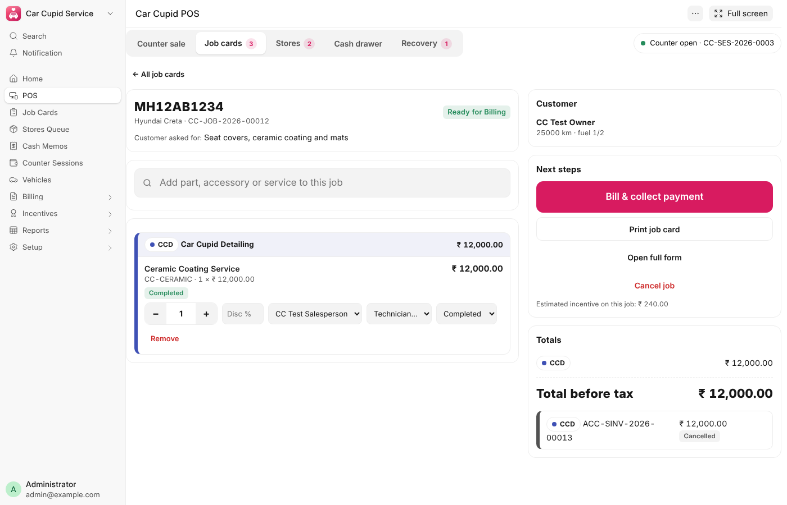
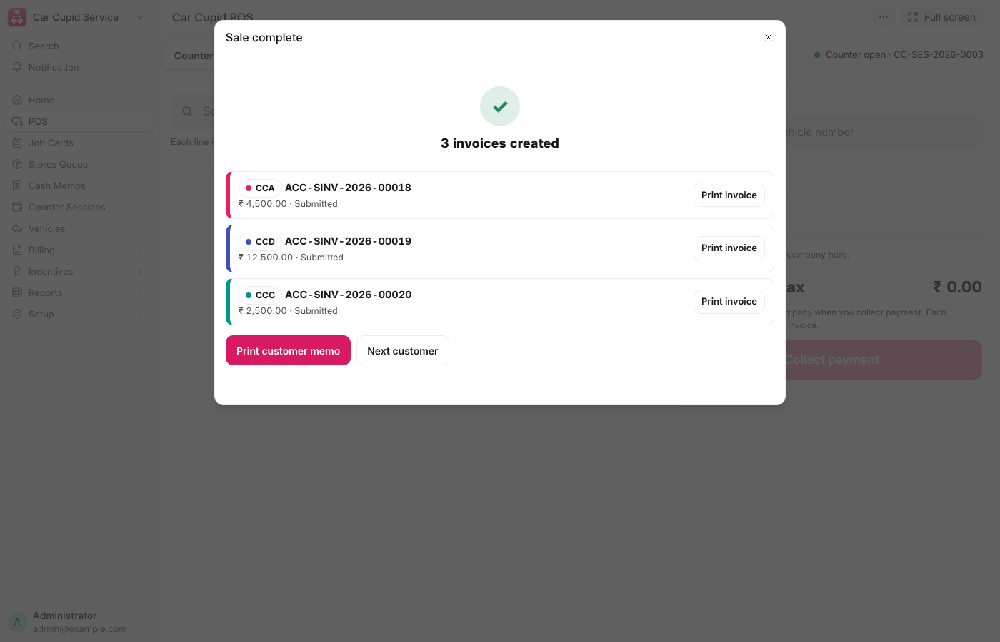
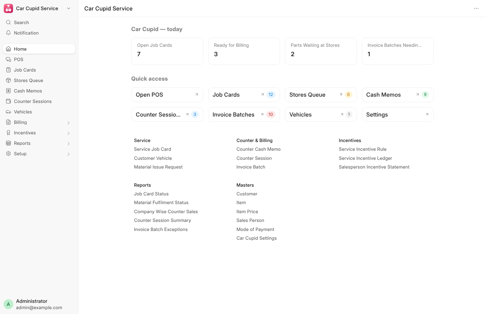
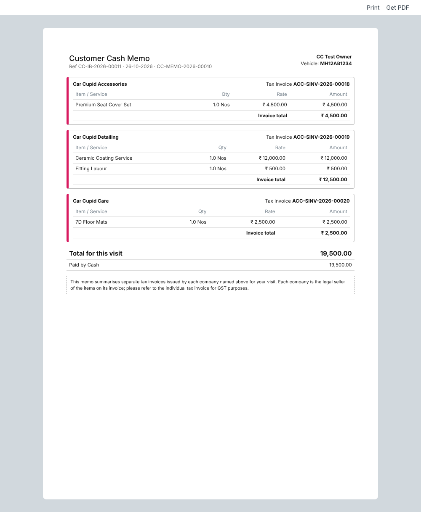

# Car Cupid Service


Custom Frappe app for **ERPNext v16** that runs a car-accessory and detailing business operating **three
legal companies on one site**: one customer checkout (service job card or counter sale), and a separate
legal Sales Invoice per company, each posted in that company's own books.

Built from the *Car Cupid Service — Development Blueprint v1.0* (25 Oct 2026).

---



## What's inside

| Area | What it does |
| --- | --- |
| **Car Cupid POS** (`/app/car-cupid-pos`) | Touch-first counter screen: counter sale, job cards, stores queue, cash drawer, billing recovery. Barcode-scanner and keyboard friendly, works on a phone. |
| **Service Job Card** | Customer + vehicle intake (odometer, fuel, damage, belongings, 4 photos), lines from any of the 3 companies, line-level company / salesperson / technician, work & stores progress, invoices list. |
| **Customer Vehicle** | Vehicle master (`Vehicle` is already an ERPNext DocType, so this is *Customer Vehicle*). Number normalised (`mh 12 ab 1234` → `MH12AB1234`), Indian format incl. BH series validated, owner change logged. |
| **Material Issue Request** | Request → issue → return tracker per job line, linked to Material Request and Stock Entries. |
| **Invoice Batch** | The multi-company billing engine's audit record: per-company invoice status, errors, attempts, payments received, allocation to each invoice. |
| **Counter Cash Memo** | Direct retail sale without a job card. |
| **Bill Discount lines** | Overall discount amount per company on a job card or cash memo; several lines, any companies on the bill. Posted as that company invoice's *Additional Discount on Net Total*, so GST and incentives use the discounted value. |
| **Counter Session** | Cash drawer: opening float, cash in/out with reasons, receipts by mode, denomination count, variance with supervisor approval. |
| **Item sales incentive** | `custom_sales_incentive` on Item (Sales tab): a fixed amount per unit. Captured on the job/memo line when the item is added and paid as qty × rate to that line's salesperson on invoice submit; credit notes and cancellations reverse it. Items with 0 fall back to the rules below. |
| **Service Incentive Rule / Ledger** | % of net sales (ex-GST), fixed per unit, or fixed per service line; most specific rule wins; reversals for credit notes and cancellations. |
| **Reports** | Job Card Status, Material Fulfilment Status, Company Wise Counter Sales, Counter Session Summary, Salesperson Incentive Statement (with *estimated* unbilled), Invoice Batch Exceptions. |
| **Print formats** | Consolidated customer memo (company-wise sections + legal note), Job Card / intake, Material Issue Slip, Counter Closing. Each company's own Sales Invoice prints with its normal format. |
| **Navigation** | App tile with the Car Cupid icon on the Apps screen, a *Car Cupid Service* workspace (live number cards + shortcuts), and a module sidebar. |

## The design decisions that keep it safe

**One invoice = one legal company.** The memo is a customer-facing summary; it never replaces the tax invoices.

**Stock leaves the books exactly once.** Store *issue* is a **Material Transfer** from the company's *Store*
warehouse to its *Service Bay (WIP)* warehouse; the **Sales Invoice (Update Stock)** deducts from the bay.
A return is a transfer back. There is no path where an issue and a sale both reduce stock.

**Billing can't double-post.**
1. Every *Collect payment* click carries a request key: a double tap or a retry after a timeout returns the same batch.
2. The source row is locked and a second concurrent billing of the same job is refused.
3. Billed quantities are read from submitted Sales Invoice rows (credit notes subtract), so they can't drift.
4. Draft invoices are built and **payment is checked before anything is submitted**.
5. Each company invoice is committed on its own: if company C fails, A and B stay, the batch is *Partially Submitted*, and **Retry** re-creates only C. An hourly job finalises any batch left *In Progress* by a crash.

**Money stays in the right books.** A split payment (cash + UPI…) is allocated proportionally (or sequentially —
setting) to each company invoice and posted as Payment Entries **in that company**, using the account set on
the Mode of Payment for that company. Change is only ever given from cash.

## Foolproofing built in

- Company is routed automatically from the item's **Item Default** (one enabled company = that company).
- Prices come from each company's price list on the server; a counter user can't override a price.
- Discount above the limit (default 10%) needs a Billing Supervisor; the approver is stamped on the line. The same limit applies to bill discounts, as a % of that company's value; an applied bill discount is frozen and re-opens if its invoice is cancelled.
- Staff linked to an Employee are normally limited by ERPNext to one company; Car Cupid widens their Company access to all enabled Car Cupid companies (on role assignment, on settings save, nightly, or via *Grant Company Access to Staff*) so a cashier can bill all three.
- Billed lines are frozen (item, company, rate, discount, UOM).
- A job line can't be reduced below what's already issued, or removed once requested/issued — only cancelled.
- Vehicle owner mismatch is flagged; a second open job for the same vehicle is offered instead of duplicated.
- Typing a mobile number that already exists re-uses that customer instead of creating a duplicate.
- The payment dialog only shows modes that have an account in **every** company on the bill, requires a UTR
  for UPI/card, shows *still to collect / give change* live, and won't let card/UPI be over-tendered.
- No payment without an open cash drawer (setting). One open drawer per cashier.
- Cash closing variance above tolerance needs a reason and supervisor approval; until then it stays *Pending Review*.
- Unsent counter sales survive a page reload or network drop (kept locally until billed).
- Cashiers only see their own counter sessions; supervisors see all.
- Stores can't over-issue, issue more than is in stock, or take back more than is with the job and unbilled.
- Errors tell the user exactly which line and what to do next.

## Implementation guide

A full implementation guide for functional consultants, with configuration steps and end-user SOPs with screenshots and worked examples, is maintained as a shared document (ask Sanvidhi Tech for the link).

## Install

```bash
cd ~/frappe-bench
bench get-app https://github.com/sanvidhi-git/service-job-card-frappe-app
bench --site <your-site> install-app car_cupid_service
bench --site <your-site> migrate
bench build --app car_cupid_service && bench restart
```

Requires Frappe and ERPNext **v16** (tested on Frappe 16.53 / ERPNext version-16, Python 3.14).

## Configure (once)

1. **Car Cupid Settings** → add the three companies. For each: chip label & colour, **Store warehouse**,
   **Service Bay (WIP) warehouse**, selling **price list**, optional tax template and cost center.
2. **Mode of Payment** → for *Cash*, *UPI*, *Card* etc. set the default account **for each of the three companies**.
3. **Items** → add an *Item Default* row for the company that sells it (this drives auto-routing).
4. **Sales Person** → link each salesperson to their Employee (with User ID) so lines default to the logged-in person.
5. **Roles** → assign: Counter Salesperson, Service Advisor, Service Engineer, Storekeeper, Cashier,
   Billing Supervisor, Incentive Manager (Accounts Manager / System Manager are standard).
   Read access to the ERPNext masters these roles need is granted automatically on install.
6. Optional: walk-in customer, vehicle mandatory for POS, partial billing, credit sales, variance tolerance,
   note denominations, incentive rules.

## Using it

Open **Car Cupid** from the Apps screen → **POS**.

- **Counter sale** – find/add the customer (name, mobile or vehicle no.), scan items, check the company split, *Collect payment* (F9), print the memo and each invoice.
- **Job cards** – *New job card* (vehicle intake) → add parts/services → *Send parts request to stores* → stores issue → mark work completed → *Bill & collect payment* → *Hand over vehicle*.
- **Stores** – issue / issue all / take back / cancel requests, with live store stock.
- **Cash drawer** – open with float, record cash in/out, count notes to close.
- **Recovery** – any batch with a failed company invoice or payment; *Retry* is always safe.

| | |
| --- | --- |
|  |  |
|  |  |

## Tests

```bash
bench --site <test-site> set-config allow_tests true
bench --site <test-site> run-tests --app car_cupid_service
```

Covers: company routing; billing blocked until issue + work completion; three-company billing with
cash + UPI and correct per-company Payment Entries; stock deducted once; idempotent retry; cancellation
re-opening the line and reversing incentives; direct POS with change; partial failure and safe retry;
short payment refused before invoicing; material return and quantity guards; counter-staff discount/price
guards and billing permission; vehicle number rules; cash closing with variance approval.
`car_cupid_service/tests/utils.py` can also seed a demo of three companies on a fresh site.

## Why the POS is inside the Frappe app (not a separate web app)

The blueprint recommends a Frappe-native POS page, and that's what this is. It reuses the logged-in desk
session, role permissions and CSRF protection, needs no CORS/API-key setup or second deployment, and every
rule runs on the server. *Full screen* mode hides the desk for a kiosk-style counter. A separate SPA would only
be worth it for offline billing, which the blueprint keeps out of scope.

## Confirm with the client's accountant before go-live

- GST treatment and wording of the consolidated memo; invoice numbering per company.
- That one shared drawer collecting for three companies (each payment posted to that company's own
  cash/bank account) is acceptable, and how cash is settled between entities.
- Item-wise tax templates per company (India Compliance), and whether prices are tax-inclusive.
- Incentive base and payout process.

## Licence

MIT — © 2026 Sanvidhi Tech Pvt Ltd
